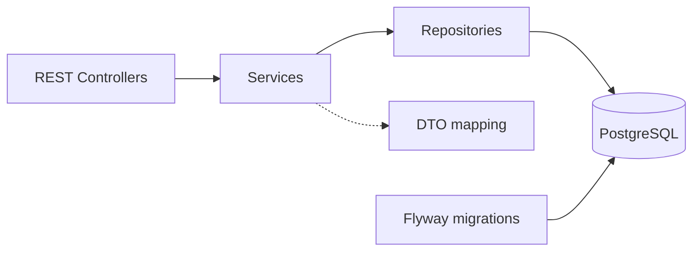

# Architecture

## 1. System Overview

The service stores structured travel transactions and builds invoices from persisted data. It uses Java 21, Spring Boot 4.1.1, Spring MVC, Jakarta Validation, Spring Data JPA/Hibernate, PostgreSQL 17, Flyway, and Gradle Kotlin DSL. It has no external booking or billing dependencies.

Packages separate responsibilities by layer and resource:

- `controller`: HTTP routing, request validation, and response status codes.
- `model/dto`: API contracts, presence-aware transaction PATCH input, and response mapping.
- `service`: aggregate operations, financial calculations, transaction boundaries, and locking.
- `repository`: persistence queries, bounded collection loading, and row locks.
- `model/entity`: transaction aggregates and invoice snapshots.
- `exception`: domain failures translated into HTTP Problem Detail responses.

Controllers return DTOs rather than managed entities. Open Session in View is disabled; services materialize responses before their database transaction ends. This makes database access explicit and prevents serialization from unexpectedly loading relationships. README contains runnable API examples.

## 2. Data Model & Persistence

Flyway owns the schema; Hibernate uses `ddl-auto=validate`, not runtime schema generation. PostgreSQL constraints complement application validation.

`transactions` holds identity, type, currency, gross total, timestamps, and JSONB metadata. `Transaction` owns separate `transaction_taxes` and `transaction_fees` collections with cascading persistence and orphan removal. Their non-null foreign keys also specify `ON DELETE CASCADE`. Separating taxes from fees preserves their distinct business meaning and supports relational lookup without forcing every product detail into tables.

JSONB accommodates flight coupons, hotel addresses, rail legs, and Navan fee details without separate product hierarchies. Hibernate uses the configured Jackson JSON mapper, including decimal-number handling. Additional metadata survives round trips; JSONB preserves values and array order, not textual object-key order or numeric formatting. Java enum constants are uppercase while JSON and stored type values remain lowercase. Timestamps use `Instant` and PostgreSQL `TIMESTAMPTZ`.

An `Invoice` owns ordered `invoice_line_snapshots`. Each line stores the source transaction ID, type, currency, total, metadata, taxes, and fees. The source ID is a scalar JPA field, with an existing database foreign key using `ON DELETE RESTRICT`. There is no entity association from a snapshot to the source transaction, preventing accidental live-data reads or cascading source deletion. Snapshot tax/fee structures are JSONB because they are frozen values rather than independently editable children. Snapshots capture transaction financial data and metadata at invoice creation; subsequent source changes do not modify them, and only explicit invoice PATCH rebuilds them.

Primary keys support resource lookup and ascending-ID lists. Additional indexes enforce or support:

- Unique `external_id`: authoritative transaction identity under concurrent creation.
- Tax/fee `transaction_id` indexes: bounded aggregate loading.
- Unique `(invoice_id, transaction_id)`: no repeated source within an invoice; its leading column also supports invoice-line loading.
- Snapshot `transaction_id` index: efficient invoice-membership checks before transaction mutation.

Check constraints restrict transaction types, uppercase currencies, tax-rate range, and JSON object/array shapes. Taxes, fees, and snapshot lines use database-ID ordering; original request array order is not guaranteed. Invoice creation adds sources in ascending transaction-ID order.

## 3. API Design & Validation

Transactions and invoices expose POST, single-resource GET, PATCH, DELETE, and paginated GET. Successful creation returns 201, reads and PATCH return 200, and DELETE returns 204. Invalid input returns 400; missing resources return 404. Duplicate external IDs, repeated invoice source IDs, mixed invoice currencies, and mutation of invoiced transactions return 409. Duplicate responses include `existing_id`.

Transaction creation requires the header, tax/fee arrays, and metadata. Type-specific validation checks flight origin/destination, fare, and every coupon; the coupons array must exist but may be empty. Hotels require name, address, stay dates, positive nights, and room rate; optional extras are validated. Rail requires nonempty legs with endpoints and timestamps. Navan fees support `trip_fee` and `agent_call_fee`. Extra metadata is retained rather than discarded by a closed product DTO.

Money uses `BigDecimal` and `NUMERIC(19,2)`: at most 17 integer digits and two fractional digits. API constraints reject excessive precision for totals and tax/fee amounts before persistence. Recognized metadata amounts use equivalent value-precision checks after stripping trailing zeros. Tax rates allow six fractional digits between zero and one. Database numeric columns alone would round excessive scale if direct SQL bypassed validation. Currency must be uppercase three-letter syntax and accepted by `Currency.getInstance()`.

Transaction PATCH distinguishes presence from value. Omitted fields remain unchanged; explicit top-level nulls return 400. Supported fields are `total`, `occurred_at`, `tax_lines`, `fee_lines`, and `metadata`. Supplied lists replace their entire collections; empty arrays clear them. Metadata is a complete replacement validated against the stored type. Identity, type, currency, and unsupported fields cannot be patched. The merged proposed state is validated before any mutation; an empty PATCH is a no-op only for an uninvoiced transaction.

Invoice POST and PATCH accept exactly one of `transaction_id` or a nonempty `transaction_ids` array. IDs must be positive signed 64-bit integers. Integer strings are supported; floating-point tokens, including `1.0`, are rejected rather than truncated. This deserialization rule is scoped to invoice ID fields.

## 4. Transaction & Invoice Lifecycle

Transaction creation persists the header, metadata, taxes, and fees atomically. Valid duplicate requests return 409 without committed changes to the existing aggregate; request validation still applies to duplicates.

Invoice creation copies current stored sources into independent snapshots. Mutable metadata is deep-copied, tax/fee value records and lists are copied, and snapshot accessors return defensive copies. Invoice reads and rollups use persisted snapshots exclusively, so even direct source-data changes cannot alter an existing invoice response.

Snapshots remain frozen until explicit invoice PATCH replaces the complete source set. Replacement preserves invoice identity and creation time, validates and copies the requested sources, removes old lines, and rebuilds totals and snapshots. Old rows are explicitly flushed out before replacements are inserted, avoiding unique-constraint violations when source IDs overlap. Flush is not commit: deletion, insertion, and header updates share one transaction, so failure restores the original invoice and snapshot rows.

Invoice DELETE removes its header and snapshots without deleting sources. A removed source becomes editable/deletable after commit only if no other invoice references it. There are no invoice lifecycle statuses.

Grand total sums source gross totals once with `BigDecimal`; taxes and fees are not added again. Overflow beyond the invoice column range is rejected before persistence. Tax rollups group exact, case-sensitive names and numerically equivalent rates, keeping absent rates distinct from zero. Fee rollups group exact names. Output sorts by name, then tax rate with absent rates first. The five supplied fixtures produce EUR 685.70.

## 5. Concurrency & Data Consistency

Writes use database transactions: transaction operations use `TransactionTemplate`; invoice operations use Spring `@Transactional`. Default REQUIRED propagation means future service composition must account for participation in an outer transaction and rollback-only behavior.

All cooperating mutations follow this locking protocol, holding `PESSIMISTIC_WRITE` locks until commit or rollback:

1. Invoice PATCH/DELETE locks the existing invoice header first.
2. Invoice PATCH locks the union of old and new source IDs in ascending order; DELETE locks its existing sources in that order. Creation locks requested sources in ascending order without an existing invoice lock.
3. Transaction PATCH/DELETE locks the source header before checking invoice membership or touching children. These operations do not acquire invoice-header locks.

Source locks are acquired individually before loading source children. A future operation involving multiple existing invoices must lock those invoice headers in ascending order before source rows. Direct database writers must follow the same parent-lock protocol to participate in these guarantees.

This serializes snapshot creation against source mutation. If attachment commits first, transaction mutation returns 409. If mutation wins, an invoice copies the complete updated aggregate or returns 404 after deletion. Removal races may return 409 before removal commits or permit mutation afterward. Snapshot foreign-key checks also take locks; referenced rows are already locked by the invoice operation. Consistent ordering reduces deadlock risk, but is not a universal guarantee against external writers or other lock patterns.

Transaction GET uses a dedicated read-only REPEATABLE_READ transaction so its separate header and child queries share one MVCC snapshot. Both list methods use their own read-only REPEATABLE_READ boundaries. Invoice GET fetches header and snapshots in one SQL statement. These read strategies leave write isolation and locking unchanged.

Duplicate identity resolution uses PostgreSQL `INSERT ... ON CONFLICT (external_id) DO UPDATE ... RETURNING`. The conflict branch assigns the existing external ID to itself, captures the row ID under lock, and throws the duplicate exception inside the write transaction. Rollback completes before HTTP 409; no no-op update is committed. Children are inserted only for a new row. This avoids a post-rollback recovery SELECT racing with DELETE: deletion winning first permits a new 201, while conflict resolution winning first captures the existing ID for 409.

The returned `xmax = 0` distinguishes insertion from the conflict-update branch. This is an intentional PostgreSQL-specific system-column dependency, tested against PostgreSQL 17, rather than a portable JPA contract.

## 6. Pagination & Performance

Lists return `items`, `limit`, and `offset`, with complete single-resource DTOs and no total-count query. Defaults are 50 and 0; limits outside 1–100 or invalid/negative offsets return 400. Empty pages return 200.

A native parent-ID query applies PostgreSQL `ORDER BY id ASC LIMIT/OFFSET` before collection loading. Transactions then fetch parents/taxes and parents/fees in separate bounded queries within one persistence context. This avoids a taxes-times-fees Cartesian product and multiple-bag fetching. Invoices use one bounded parent/snapshot query, never current source transactions. Collection fetch queries have no pagination.

Results are deduplicated by parent ID, then mapped in the exact order of the original ID page. DTO conversion occurs after collections are initialized. Hibernate statement-count tests cover full HTTP mapping:

| Returned parents | Transactions | Invoices |
|---|---:|---:|
| 1, 50, or 100 | 3 queries | 2 queries |
| Empty page | 1 query | 1 query |

High volume: hot source/invoice locks serialize conflicting writes, duplicate POSTs contend on the unique index, and large/deep lists consume database I/O and connections. Indexes, bounded parent pages, and fixed-query fetching address these costs without additional infrastructure. Parent limits do not bound child counts or JSON size; fetch joins repeat header data per child. Separate page requests do not share snapshots, so concurrent changes can shift OFFSET boundaries.

## 7. Testing Strategy

With Java 21 and Docker available, run `./gradlew test`. Tests start PostgreSQL 17 Testcontainers, apply Flyway migrations, enable Hibernate schema validation, and exercise HTTP endpoints on random ports. They do not require the development database or `.env`. Tests run sequentially because database cleanup is shared; concurrency scenarios explicitly coordinate overlapping requests.

Coverage includes all five fixtures, EUR 685.70 totals and rollups, metadata round trips, validation, duplicate identity, CRUD conflicts, and snapshot independence after direct source header/metadata/tax/fee changes. Forced database failures verify aggregate and snapshot-replacement rollback. Controlled concurrent tests cover duplicate/create/delete races, transaction and invoice PATCH/DELETE, attachment/removal races, foreign-key interactions, and consistent reads. Pagination tests inspect SQL, statement counts, parent/child loads, ordering, and complete nested data. Tested schedules provide evidence, not proof of every possible interleaving.

## 8. Trade-offs & Future Improvements

PostgreSQL JSONB, native pagination, row locks, and conflict resolution favor explicit behavior on the assignment stack over database portability. The `xmax` dependency deserves revalidation on database upgrades. Individual source locks and child loading keep invoice writes understandable but add queries as invoice size grows.

There is no configured lock/statement timeout or deadlock retry policy. Short transactions limit normal contention, but a stalled holder can cause prolonged waits. Production hardening should choose bounded waits and API error semantics together rather than add broad retries.

For sustained volume, consider cursor pagination, payload/source-count limits, and targeted CREATE query optimization. Another future optimization would acquire source row locks in deterministic ascending ID order, then batch-load related data for those locked sources; this is not currently implemented. Current CREATE performs three SELECTs: managed-header hydration and tax/fee initialization during response mapping. Longer REPEATABLE_READ operations also retain old row versions. These are explicit scaling limits; caches, messaging, and distributed locks are unnecessary for the present scope.
